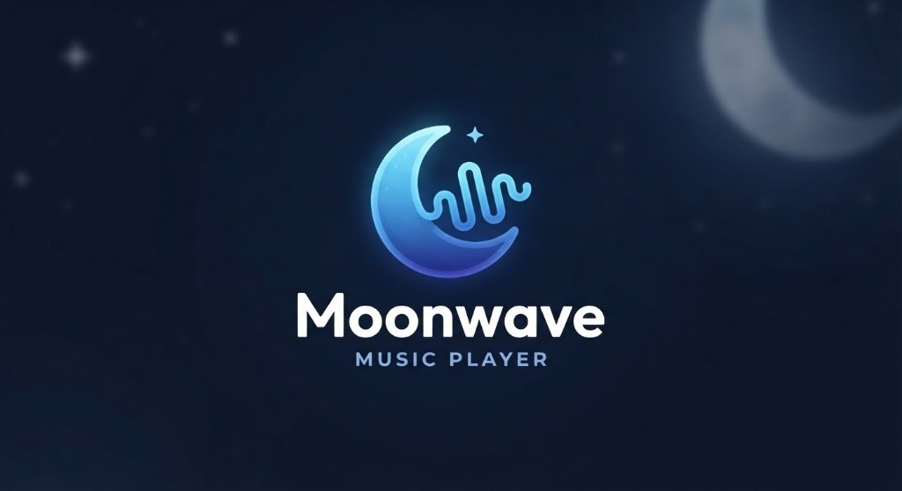

  

<h1 align="center">MOONWAVE</h1>

  <b>A Premium Android Music Platform with YouTube Music Streaming, Multi-Provider Karaoke Lyrics, Music Haptics, and Offline Library Playback.</b>

  <i>Powered by the architecture, audio engine, and design system of <b>SpatialFlow</b>.</i>

  
  
  

---

## 🌟 Key Features

### 🎧 Hybrid Online & Offline Playback
- **YouTube Music Streaming**: Stream millions of online tracks directly with fast caching & background prefetch.
- **NewPipe Native Stream Extractor**: Direct on-device audio stream extraction without third-party proxy dependencies.
- **Offline Local Library**: High-speed storage scanner for MP3, FLAC, AAC, WAV, and OGG formats with metadata tagging.
- **Seamless Unified Queue**: Mix online streams and local tracks into one synchronized queue.

### 🎤 Next-Generation Karaoke Lyrics
- **Word-by-Word Synchronized Lyrics**: Real-time karaoke highlighting with smooth auto-scrolling and tap-to-seek.
- **Multi-Provider Engine**: Automatic fallback across 6+ providers:
  - Apple Music
  - Spotify
  - Musixmatch
  - LRCLIB
  - SyncLRC
  - YouTube Music
  - Local Embedded ID3 tags
- **Global Multi-Language Support**: English, Spanish, Hindi, Japanese, Korean, and more.

### 📳 Music Haptics
- **Tactile Beat Feedback**: Dynamic rhythm and bass vibration feedback synced with audio playback.
- **Interactive Playback Haptics**: Subtle tactile responses on seek, favorites, and volume changes.

### 🎛️ Studio-Grade Audio Lab
- **Hardware Equalizer & Bass Boost**: Fully responsive frequency sliders with audio effect presets.
- **Loudness Analyzer & Volume Normalizer**: EBU R128 loudness measurement with automatic volume leveling.
- **Gapless Playback & Crossfade**: Smooth transitions between songs.

### 🎨 Material 3 Expressive UI
- **Liquid Glass Dynamic Effects**: Fluid real-time gradients extracted dynamically from album artwork.
- **Wavy Music Slider**: Interactive animated waveform seek bar.
- **Sliding Queue Drawer & Sleep Timer**: Intuitive gestures and time-based sleep scheduler.
- **Desktop Widgets**: Aura (2x2), Waveform Bridge (4x2), and Full Music Dashboard (4x4).
- **Tag Editor**: Edit title, artist, album, and lyrics directly in the app.

---

## 🤝 Open Source Credits & Acknowledgements

MOONWAVE is built upon and incorporates code, design, and audio architecture from the following outstanding open-source projects:

### 🌟 SpatialFlow (Core Foundation)
- **Original Creator & Architect:** **Shubham Karande** ([@MythicalSHUB](https://github.com/MythicalSHUB))
- **Repository:** [https://github.com/MythicalSHUB/SpatialFlow](https://github.com/MythicalSHUB/SpatialFlow)
- **License:** [Apache License 2.0](LICENSE)
- Special thanks to Shubham Karande and CodeTrio for creating the beautiful UI, NewPipe streaming integration, multi-provider lyrics engine, audio normalizer, and music haptics that power MOONWAVE.

### 📚 Libraries & Frameworks
- **[AndroidX Media3 / ExoPlayer](https://github.com/androidx/media)**: Reliable background audio engine and session services.
- **[NewPipe Extractor](https://github.com/TeamNewPipe/NewPipeExtractor)**: YouTube audio stream extraction engine.
- **[Gramophone](https://github.com/AkaneTan/Gramophone)**: Synchronized lyrics parsing and semantic utilities (`org.akanework.gramophone`).
- **[LRCLIB](https://github.com/tranxuanthang/lrclib)**: Open-source synchronized lyric database.
- **[Jaudiotagger](https://www.jthink.net/jaudiotagger/)**: Audio metadata and ID3 tagging library.
- **[Coil](https://github.com/coil-kt/coil)** & **[Glide](https://github.com/bumptech/glide)**: Hardware-accelerated image caching.
- **[FFmpegKit](https://github.com/arthenica/ffmpeg-kit)**: High-performance audio conversion and processing.

---

## 📱 Installation

Download the latest production APK from [Releases](https://github.com/rmdmahfuz727-sudo/MOONWAVE/releases):

1. **`MOONWAVE-SpatialFlow-release.apk`**: Signed production APK ready to install on Android 7.0+ (API 25+).
2. **`MOONWAVE-SpatialFlow-debug.apk`**: Debug build for developer testing and logging.

---

## 👨‍💻 Project Maintainer

- **Maintainer:** [Mahfuz Rahman](https://github.com/rmdmahfuz727-sudo)
- **Repository:** [rmdmahfuz727-sudo/MOONWAVE](https://github.com/rmdmahfuz727-sudo/MOONWAVE)

---

## 📄 License

This project is licensed under the Apache License 2.0 - see the [LICENSE](LICENSE) and [NOTICE](NOTICE) files for details.
